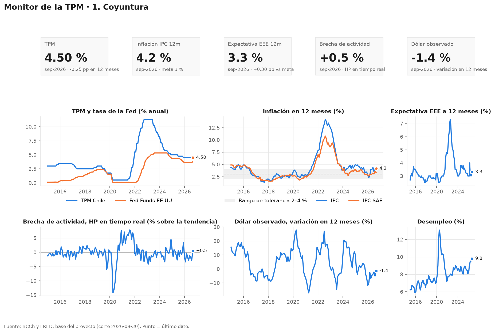
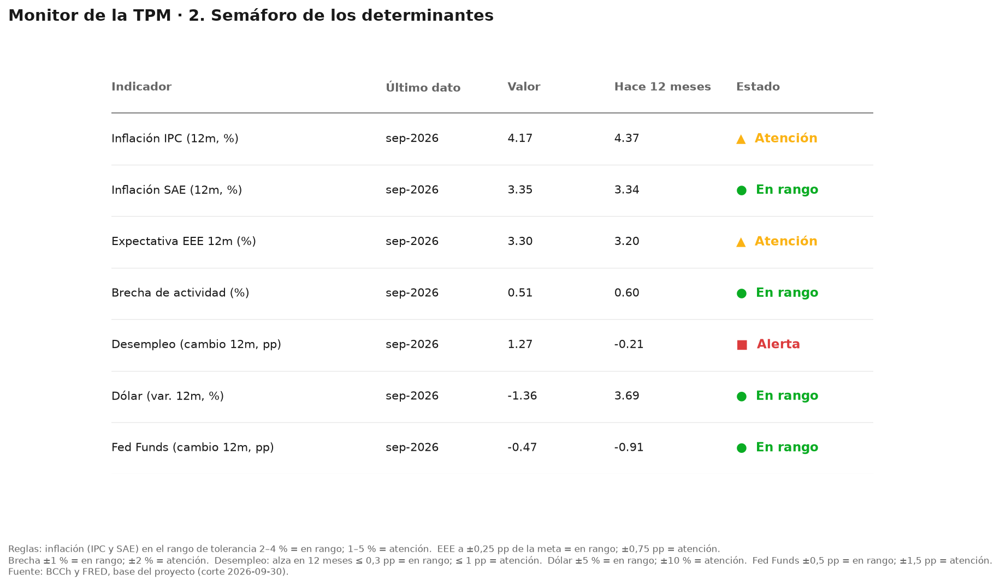
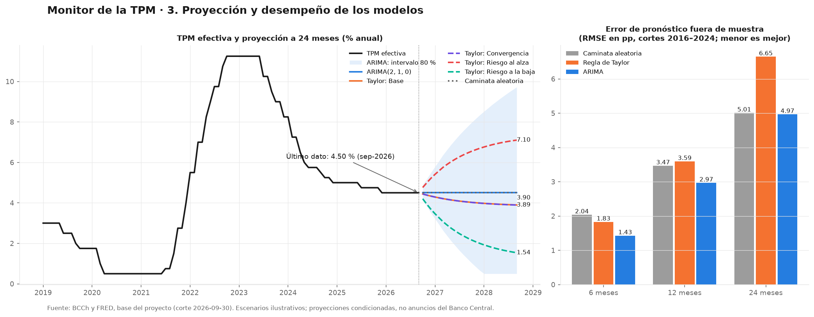

# La TPM en Chile: monitor de coyuntura y proyección con una regla de política monetaria.

**Proyecto del curso Ciencia de Datos para la Economía (ICO09425), Facultad de Administración y Economía, Universidad Diego Portales.**

**Profesor:** Luis Cuevas

**Integrantes:** Daniel Cornejo, Catarí Garrido, Laura Ruiz, Francisca Silva

> Este trabajo es un ejercicio académico; las proyecciones no representan pronósticos oficiales ni recomendaciones de política o de inversión.

---

## Contenido

1. [Estado del proyecto](#estado-del-proyecto)
2. [Contexto y pregunta de proyección](#contexto-y-pregunta-de-proyección)
3. [Arquitectura del flujo de trabajo](#arquitectura-del-flujo-de-trabajo)
4. [Datos](#datos)
5. [Base de datos](#base-de-datos)
6. [Consultas SQL](#consultas-sql)
7. [Análisis de coyuntura](#análisis-de-coyuntura)
8. [Modelos y resultados (Hito 3)](#modelos-y-resultados-hito-3)
9. [Dashboard](#dashboard)
10. [Cómo reproducir el proyecto](#cómo-reproducir-el-proyecto)
11. [Estructura del repositorio](#estructura-del-repositorio)
12. [Trabajo en equipo con Git](#trabajo-en-equipo-con-git)
13. [Hitos del proyecto](#hitos-del-proyecto)
14. [Referencias](#referencias)

---

## Estado del proyecto

| Requisito | Dónde está | Estado |
|---|---|---|
| Extracción programática de 12 o más series reales, con un solo comando | `carga.py` (usa `extraccion/E_BCCH.py` y `extraccion/E_FRED.py`) | ✓ 13 series del BCCh y FRED |
| Credenciales fuera del código | `.env` local, creado desde `.env.example` (no se sube) | ✓ |
| Base relacional con 3 o más tablas, llaves primarias y foráneas | `bd/crear_base.py` → `data/base.db` (`temas`, `series`, `observaciones`) | ✓ |
| Consultas SQL comentadas con JOIN, GROUP BY y función de ventana | `sql/consultas.sql` | ✓ |
| Correlaciones y rezagos entre la TPM y sus determinantes | `modelos/correlaciones_tpm.py` | ✓ |
| Modelos: ARIMA y regla de Taylor (inercia y Fed Funds), con significancia | `modelos/arima_tpm.py`, `modelos/regla_taylor.py`, `modelos/significancia_taylor.py` | ✓ |
| Evaluación fuera de muestra contra un benchmark ingenuo, sin sesgo de anticipación | `modelos/datos_modelo.py`, `modelos/evaluacion_arima.py`, `modelos/evaluacion_taylor.py`, `modelos/comparacion_modelos.py` | ✓ |
| Proyección a 6–24 meses con escenarios de riesgo, guardada en la base | `modelos/proyeccion_escenarios.py` → tablas `proyecciones_tpm` y `metricas_modelos` | ✓ |
| Todo el análisis con un solo comando | `ejecutar_todo.py` | ✓ |
| Dashboard en Python generado desde la base | `dashboard/dashboard_tpm.py` → `hito_3/dashboard/` (3 láminas) | ✓ Se regenera con `ejecutar_todo.py` |
| Versión exploratoria del dashboard en Power BI (Hito 2) | `dashboard/monitor_tpm.pbix` | Complementaria; ver [Dashboard](#dashboard) |
| Informe final y presentación | — | En desarrollo |
| Entrega con tag | Tag `hito-2` (Hito 2); tag `hito-3` al cierre | Hito 3 pendiente |

**Fecha de corte de los datos:** `2026-09-30`. Todos los resultados de este README corresponden a esa fecha y se reproducen con `python ejecutar_todo.py`.

---

## Contexto y pregunta de proyección

La Tasa de Política Monetaria (TPM) es el principal instrumento del Banco Central de Chile (BCCh) para cumplir su meta de inflación de 3 %. Sus cambios se transmiten a las tasas de mercado, al tipo de cambio, a la demanda y a las expectativas, y con ello a la actividad y a la inflación (Banco Central de Chile, 2020). En los últimos años la TPM llegó a un máximo de 11,25 % (2022–2023) y luego bajó a 4,5 %.

**Variable objetivo:** TPM (% anual), valor de fin de mes, desde agosto de 2001. Se descarga la serie diaria `F022.TPM.TIN.D001.NO.Z.D` del BCCh: la serie mensual (`…Z.M`) dejó de responder en la API. Se usa el valor de fin de mes, y no el promedio, porque la TPM cambia en fechas puntuales (las reuniones de política monetaria) y el promedio de un mes con cambio daría una tasa que nunca estuvo vigente. Antes de agosto de 2001 la TPM estaba expresada en UF (tasa real) y no es comparable con la actual.

**Horizonte:** 6 a 24 meses.

**Pregunta que guía el trabajo:**

> ¿Cuál es la trayectoria esperada de la TPM en Chile durante los próximos 6 a 24 meses, según la evolución de sus principales determinantes macroeconómicos y una regla de política monetaria estimada con datos chilenos?

---

## Arquitectura del flujo de trabajo

Todo el flujo es programático: no hay descargas manuales ni pasos intermedios a mano.

```
APIs (BCCh + FRED) ──▶ CSV en data/raw/ ──▶ SQLite data/base.db ──▶ sql/consultas.sql ──▶ modelos/ y notebooks/ ──▶ hito_3/resultados y graficos
   extraccion/*.py                           bd/crear_base.py         JOIN · GROUP BY ·      (Python)                 + tablas proyecciones_tpm y
                                                                       función de ventana                              metricas_modelos en la base
└──────── carga.py: descarga y crea la base ────────┘
└──────────────────────────────── ejecutar_todo.py: corre todo el flujo con un solo comando ────────────────────────────────┘
```

---

## Datos

### Catálogo de series

Se usan **13 series**, todas descargadas por API: 9 desde la Base de Datos Estadísticos del Banco Central de Chile (servicio SieteRestWS) y 4 desde FRED (Reserva Federal de St. Louis). La justificación de cada serie también está comentada junto a su código en `extraccion/E_BCCH.py` y `extraccion/E_FRED.py`.

| # | Nombre | Serie | Código API | Fuente | Frec. original | Tema | Período | Meses con dato |
|---|---|---|---|---|---|---|---|---|
| 1 | `tpm` | Tasa de política monetaria, valor de fin de mes | `F022.TPM.TIN.D001.NO.Z.D` | BCCh | Diaria | Política monetaria | 2001-08 a 2026-09 | 302 |
| 2 | `ipc` | IPC general, variación mensual | `F074.IPC.VAR.Z.Z.C.M` | BCCh | Mensual | Precios | 2000-01 a 2026-09 | 321 |
| 3 | `ipc_sae` | IPC sin alimentos ni energía, variación mensual empalmada (INE, base 2023) | `F074.IPCSAE.VAR.Z.EP23.Z.M` | BCCh | Mensual | Precios | 2010-01 a 2026-09 | 201 |
| 4 | `expectativa_ipc_eee` | Expectativa de inflación a 12 meses (EEE), mediana | `F089.IPC.V12.14.M` | BCCh | Mensual | Expectativas | 2001-01 a 2026-09 | 302 |
| 5 | `imacec` | Imacec, índice original (referencia 2018) | `F032.IMC.IND.Z.Z.EP18.Z.Z.0.M` | BCCh | Mensual | Actividad | 2000-01 a 2026-09 | 321 |
| 6 | `desempleo` | Tasa de desocupación nacional (INE) | `F049.DES.TAS.INE9.10.M` | BCCh | Mensual | Mercado laboral | 2010-03 a 2026-09 | 199 |
| 7 | `dolar_observado` | Dólar observado, promedio mensual | `F073.TCO.PRE.HIST.M` | BCCh | Mensual | Tipo de cambio | 2000-01 a 2026-09 | 321 |
| 8 | `tasa_bcp_10` | Tasa de bonos en pesos a 10 años, mercado secundario | `F022.BCLP.TIS.AN10.NO.Z.D` | BCCh | Diaria | Tasas de mercado | 2004-07 a 2026-09 | 267 |
| 9 | `tasa_bcu_10` | Tasa de bonos en UF a 10 años, mercado secundario | `F022.BUF.TIS.AN10.UF.Z.D` | BCCh | Diaria | Tasas de mercado | 2002-09 a 2026-09 | 289 |
| 10 | `precio_cobre` | Precio internacional del cobre (FMI) | `PCOPPUSDM` | FRED | Mensual | Externo | 2000-01 a 2026-09 | 321 |
| 11 | `fed_funds` | Tasa de fondos federales de EE.UU. | `FEDFUNDS` | FRED | Mensual | Externo | 2000-01 a 2026-09 | 321 |
| 12 | `ipc_eeuu` | IPC de EE.UU. (CPI-U), desestacionalizado | `CPIAUCSL` | FRED | Mensual | Externo | 2000-01 a 2026-09 | 320 |
| 13 | `produccion_industrial_eeuu` | Producción industrial de EE.UU., desestacionalizada | `INDPRO` | FRED | Mensual | Externo | 2000-01 a 2026-09 | 321 |

### Por qué está cada serie

| Serie | Rol | Mecanismo y signo esperado sobre la TPM |
|---|---|---|
| `tpm` | Objetivo | La TPM se ajusta de forma gradual: su propio pasado la explica (inercia). |
| `ipc` | Explicativa | Si la inflación se aleja de la meta de 3 %, el BCCh mueve la TPM en la misma dirección (+). Se publica con rezago: en los modelos se usará rezagada. |
| `ipc_sae` | Explicativa | Inflación subyacente, sin los precios más volátiles: si sube, la presión es persistente (+). |
| `expectativa_ipc_eee` | Explicativa | La regla de Taylor responde a la inflación esperada (+). Se conoce antes que el IPC. |
| `imacec` | Explicativa | Con el filtro HP se obtiene la brecha de actividad: una economía sobre su potencial presiona la inflación (+). |
| `desempleo` | Explicativa | Más holgura laboral implica menos presión salarial e inflacionaria (−). |
| `dolar_observado` | Explicativa | Canal cambiario: una depreciación encarece los importados y eleva la inflación (+). |
| `fed_funds` | Explicativa | Un alza de la Fed amplía el diferencial de tasas y presiona al peso (+). |
| `ipc_eeuu` | Contexto | Inflación externa que entra por los bienes importados (+). |
| `precio_cobre` | Contexto | Términos de intercambio: aprecia el peso (−) pero impulsa la actividad (+); efecto ambiguo. |
| `produccion_industrial_eeuu` | Contexto | Ciclo de la demanda externa (+ leve). |
| `tasa_bcp_10`, `tasa_bcu_10` | Contexto | Transmisión de la TPM a las tasas nominales y reales de largo plazo. |

### Tratamiento de fechas, frecuencias, faltantes y errores

- **Fecha de corte:** `2026-09-30`, definida en `carga.py` (`FECHA_CORTE`) y modificable con `--hasta`. Se descartan los datos posteriores, para que el resultado sea reproducible.
- **Inicio:** se pide desde `2000-01-01`; cada serie parte en su primer dato disponible.
- **Frecuencia:** todo se guarda mensual, con fecha el día 1 del mes. Las series diarias se convierten a mensual en Python, con la función `a_mensual` de los scripts de extracción, antes de cargarse a la base: las tasas de bonos como promedio del mes y la TPM como valor de fin de mes.
- **Datos faltantes:** los meses sin dato se guardan como `NULL`; no se rellenan ni se eliminan. A la fecha de corte hay 8: 7 de la EEE y 1 del IPC de EE.UU.
- **Rezagos de publicación:** con la descarga más reciente todas las series llegan a 2026-09. En los modelos, cada serie entra rezagada según cuándo se publica (ver [Modelos y resultados](#modelos-y-resultados-hito-3)).
- **Historia:** todas las series tienen al menos 10 años de datos mensuales. Las más cortas son el IPC SAE (empalmado por el INE, desde 2010-01) y la desocupación (desde 2010-03).
- **Errores:** cada descarga se reintenta hasta 3 veces. Si una serie falla, se informa como `[ERROR]` y **la base no se crea**, para no mezclar datos nuevos con CSV de una descarga anterior. Sin conexión, el proceso se detiene. En FRED, una API key inválida detiene la descarga y el error 429 (exceso de consultas) hace esperar antes de reintentar.
- **Credenciales:** se leen desde `.env` y se reemplazan por `***` en cualquier mensaje de error.

### Datos reales, no sintéticos

El proyecto no usa datos de prueba: no existe una opción `--demo`, y la base solo se llena desde las APIs. Una forma rápida de comprobarlo es revisar los rangos: en la base, la TPM va de 0,5 % a 11,25 % y la desocupación de 5,8 % a 13,1 %, valores consistentes con la historia chilena.

---

## Base de datos

Base SQLite `data/base.db`, creada por `bd/crear_base.py`:

| Tabla | Contenido | Llaves |
|---|---|---|
| `temas` | Clasificación temática (8 temas) | PK `id_tema` |
| `series` | Catálogo: nombre, código API, fuente, frecuencia original, tipo (`tasa`, `indice`, `nivel`, `variacion`), unidad, descripción y tema (13 series) | PK `id_serie`; FK `id_tema` → `temas`; único (`fuente`, `codigo`) |
| `observaciones` | Una fila por serie y mes (3.814 filas) | PK (`id_serie`, `fecha`); FK `id_serie` → `series` |
| `proyecciones_tpm` | Proyección de la TPM a 24 meses por modelo y escenario, con el intervalo del ARIMA (144 filas). La crea `modelos/proyeccion_escenarios.py` | PK (`fecha_corte`, `mes`, `modelo`, `escenario`) |
| `metricas_modelos` | MAE, RMSE y R² fuera de muestra de cada modelo y horizonte (18 filas). La crea `modelos/proyeccion_escenarios.py` | PK (`evaluacion`, `horizonte`, `modelo`) |

La vista `v_observaciones` une las tres tablas de datos (tema, serie, frecuencia, fecha y valor). Las tablas `proyecciones_tpm` y `metricas_modelos` guardan los resultados de los modelos, para que el dashboard y el informe los lean desde la base y no desde archivos sueltos.

**Controles de calidad de la carga:**

- Cada CSV se valida antes de insertarse: columnas, fechas `AAAA-MM-DD` sin duplicados, valores numéricos y nombre de serie igual al nombre del archivo.
- La base tiene restricciones `CHECK`: fechas válidas y siempre día 01, fuente, frecuencia y tipo dentro de los valores permitidos.
- La llave primaria (`id_serie`, `fecha`) impide observaciones duplicadas, y la llave foránea impide observaciones de series que no están en el catálogo.
- La base se construye en un archivo temporal, en una sola transacción. Se verifica con `PRAGMA integrity_check` y `PRAGMA foreign_key_check` y solo entonces reemplaza a la anterior.
- Al terminar, `carga.py` muestra la consulta de revisión de la guía (tema → serie → número de observaciones, desde y hasta), para detectar series vacías, descontinuadas o con poca historia.

---

## Consultas SQL

Archivo `sql/consultas.sql`, con tres consultas comentadas. El notebook las lee desde el archivo y las ejecuta con `pd.read_sql`: la variación en 12 meses no se recalcula en Python.

| # | Qué entrega | Técnica SQL |
|---|---|---|
| 1 | Cada observación con el nombre, tipo, unidad y frecuencia de su serie y su tema (panel completo) | `JOIN` entre `observaciones`, `series` y `temas` |
| 2 | Valor de cada serie por mes (`AVG`) y número de observaciones válidas en el mes (`COUNT`). Como los datos ya se guardan mensuales, `n_obs` funciona como control de calidad: 1 = un dato por serie y mes, 0 = mes sin dato | `JOIN` + `GROUP BY` |
| 3 | Variación en 12 meses de cada serie según su tipo: índices y niveles → variación %; tasas → diferencia en puntos porcentuales; series que ya son variación mensual (IPC, IPC SAE) → inflación compuesta de los últimos 12 meses | Funciones de ventana `LAG` y `SUM … OVER`, con `PARTITION BY id_serie ORDER BY mes` |

**Decisiones de la función de ventana:**

- `PARTITION BY id_serie` impide que el valor "de hace 12 filas" pertenezca a otra serie.
- La ventana trabaja sobre series ya mensuales: 12 filas atrás son 12 meses atrás. Esto supone que no faltan meses; se cumple porque la conversión a mensual crea una fila por cada mes, aunque su valor sea `NULL`.
- A una tasa no se le calcula variación porcentual: pasar de 5 % a 6 % se informa como +1 punto porcentual, no como +20 %.

**Ejecutar las consultas sin abrir el notebook** (desde la raíz del proyecto, con el entorno activado):

```bash
python -c "import sqlite3; con = sqlite3.connect('data/base.db'); [print(f'Consulta {i}:', len(con.execute(q).fetchall()), 'filas') for i, q in enumerate(open('sql/consultas.sql', encoding='utf-8').read().split(';'), 1) if q.strip()]"
```

Con la fecha de corte 2026-09-30, cada consulta entrega 3.814 filas.

---

## Análisis de coyuntura

El notebook `notebooks/02_analisis_coyuntura.ipynb` lee las consultas, aplica las transformaciones y construye cinco gráficos, cada uno con título, unidad, fuente, período y una lectura económica:

1. Tasa de Política Monetaria.
2. Inflación anual total y subyacente (SAE) frente a la meta de 3 % y su rango de tolerancia (2–4 %).
3. Imacec desestacionalizado, tendencia HP y brecha de actividad, en paneles separados.
4. Tipo de cambio nominal y expectativas de inflación a 12 meses (EEE).
5. Tipo de cambio nominal y real (índice, base 100 = promedio del período).

| Transformación | Cómo se hace | Dónde |
|---|---|---|
| Variación en 12 meses | Según el tipo de serie (ver consulta 3) | SQL |
| Desestacionalización del Imacec | Razón a media móvil: promedio móvil centrado de 12 meses y factor estacional promedio por mes, normalizado a 1 | Notebook |
| Brecha de actividad | Filtro de Hodrick-Prescott sobre `100 · log(Imacec desestacionalizado)`, λ = 14.400, implementado con `numpy` | Notebook |
| Tipo de cambio real | TCN × IPC EE.UU. / IPC Chile (el IPC chileno se encadena a índice desde su variación mensual) | Notebook |

### Principales hallazgos (datos a septiembre de 2026)

- **TPM:** 4,5 %, 6,75 puntos porcentuales bajo su máximo de 11,25 % (2022–2023) y estable en los últimos meses.
- **Inflación:** el IPC total crece 4,2 % anual, en el límite superior del rango de tolerancia; el IPC SAE, 3,4 %. La presión se concentra en los componentes volátiles y no en una presión de demanda generalizada.
- **Actividad:** la brecha HP promedia −1,5 % en el último trimestre (se usa el promedio porque el filtro es inestable en el extremo de la muestra). La economía opera bajo su potencial.
- **Tipo de cambio:** el peso sigue débil en perspectiva histórica, pero en 12 meses se apreció 1,4 % en términos nominales y 2,5 % en términos reales.
- **Expectativas:** la EEE a 12 meses está en 3,3 %, levemente sobre la meta.

**Lectura:** el diagnóstico apunta a un shock de oferta. En la regla de Taylor los dos términos tiran en direcciones opuestas: la inflación pide una TPM más alta y la brecha negativa una más baja. Eso es consistente con que el BCCh mantenga la tasa en 4,5 %, mientras las expectativas de mediano plazo sigan ancladas.

---

## Modelos y resultados (Hito 3)

Todos los scripts están en `modelos/` y se ejecutan en orden con `python ejecutar_todo.py`. Las tablas quedan en `hito_3/resultados/` y los gráficos en `hito_3/graficos/`. El detalle y la discusión están en `hito_3/resultados_taylor.md` y `hito_3/analisis_proyecciones.md`.

### Datos para los modelos, sin sesgo de anticipación

`modelos/datos_modelo.py` arma el panel mensual con el que se estiman y evalúan todos los modelos. Cada fila del mes *t* contiene solo información disponible al cierre del mes *t−1*:

- **Rezagos de publicación:**
  - TPM, EEE, Fed Funds y dólar: 1 mes.
  - IPC, IPC SAE, desempleo y cobre: 2 meses.
  - Imacec: 3 meses.
- **Brecha de actividad en tiempo real:** el filtro HP se recalcula cada mes usando solo el Imacec conocido hasta ese momento (filtro "de una cola"). La brecha calculada con toda la muestra usa datos futuros y se usa solo para describir el pasado. La correlación entre ambas es 0,71.
- **Lo que ya calcula SQL se lee de la base:** los promedios mensuales y las variaciones en 12 meses vienen de `sql/consultas.sql` y no se recalculan en Python.

### Relaciones entre la TPM y sus determinantes

`modelos/correlaciones_tpm.py` correlaciona el cambio en 12 meses de la TPM con cada determinante, rezagado de 0 a 24 meses. Se usan cambios y no niveles, para evitar correlaciones espurias entre series con tendencia.

| Variable | Rezago de mayor correlación | Correlación | Lectura |
|---|---|---|---|
| Expectativa de inflación (EEE) − meta | 1 mes | 0,71 | La relación más fuerte: el BCCh reacciona a la inflación esperada |
| Inflación IPC / SAE (12m) | 0 meses | 0,66 / 0,55 | Se mueven junto con la TPM |
| Imacec (var. 12m) | 9 meses | 0,53 | La actividad se adelanta a la TPM |
| Cobre (var. 12m) | 12 meses | 0,50 | Mejores términos de intercambio anticipan alzas |
| Fed Funds (cambio 12m) | 0 meses | 0,39 | Ciclo global común |
| Desempleo (cambio 12m) | 24 meses | +0,69 (−0,34 en el mismo mes) | El efecto contemporáneo tiene el signo esperado; el de 24 meses refleja el ciclo económico |
| Dólar (var. 12m) | 9 meses | −0,33 | Signo contrario al esperado: el dólar sube en crisis globales, cuando el BCCh baja la tasa |

Correlación no implica causalidad: la tabla muestra qué se mueve junto y en qué orden.

### Modelos

- **ARIMA** (`modelos/arima_tpm.py`):
  - La TPM no muestra estacionalidad (autocorrelación de 0,01 en el rezago 12), por eso se usa ARIMA y no SARIMA.
  - El orden se elige por AIC con datos hasta 2024-12: **ARIMA(2,1,0)**, con coeficientes de 0,37 y 0,30. Captura el "momentum" de los ciclos de política monetaria.
  - Los residuos no tienen autocorrelación (Ljung-Box, p = 0,97).
  - El test ADF no rechaza estacionariedad en nivel, pero la evaluación fuera de muestra respalda modelar en diferencias: el ARIMA con d = 0 es el peor en todos los horizontes.
- **Regla de Taylor** (`modelos/regla_taylor.py` y `modelos/significancia_taylor.py`): MCO con errores robustos HAC (Newey-West, 12 rezagos), entrenamiento 2005-03 a 2024-12.

```
TPM_t = c + ρ·TPM_t−1 + β_π·(EEE_t − 3) + β_y·brecha_t + β_f·FedFunds_t
```

| Variable | Coeficiente | p-valor | Respuesta de largo plazo β/(1−ρ) | p-valor |
|---|---:|---:|---:|---:|
| TPM rezagada (ρ, inercia) | 0,908 | 0,000 | | |
| Brecha de inflación esperada | 0,313 | 0,000 | 3,40 | 0,000 |
| Brecha de actividad | 0,029 | 0,059 | 0,32 | 0,029 |
| Fed Funds | 0,031 | 0,313 | 0,34 | 0,172 |

R² = 0,984. Lectura de los resultados:

- La **inercia** es alta (0,91), en línea con Apablaza y Ortiz (2024).
- La respuesta a la **inflación esperada** es mayor que 1, así que se cumple el principio de Taylor.
- La **actividad** importa menos.
- La **Fed Funds** no es significativa una vez que se controla por expectativas y actividad.
- Frente a Caputo y Herrera (2013) (1,174; 0,656; 1,2), los signos coinciden, pero la respuesta a la inflación es mayor y a la Fed menor.

### Evaluación fuera de muestra

`modelos/comparacion_modelos.py` compara los tres modelos con el mismo diseño:

- Nueve cortes, en septiembre de cada año entre 2016 y 2024.
- En cada corte, cada modelo se estima solo con los datos hasta ese mes y pronostica a 6, 12 y 24 meses.
- El benchmark es la caminata aleatoria (la TPM se mantiene en su último valor).

RMSE en puntos porcentuales de TPM; entre paréntesis, el R² fuera de muestra frente a la caminata aleatoria (positivo = le gana):

| Horizonte | Caminata aleatoria | Regla de Taylor | ARIMA |
|---|---:|---:|---:|
| 6 meses | 2,04 | 1,83 (+0,19) | **1,43 (+0,51)** |
| 12 meses | 3,47 | 3,59 (−0,07) | **2,97 (+0,27)** |
| 24 meses | 5,01 | 6,65 (−0,76) | 4,97 (+0,02) |

- **El ARIMA es el más preciso a 6 y 12 meses.**
- **La regla de Taylor solo mejora al benchmark a 6 meses.** A 12 y 24 meses pierde, porque sus determinantes se mantienen fijos en el valor del corte.
- **A 24 meses ningún modelo supera con claridad a la caminata aleatoria.**

Evaluaciones complementarias:

- `modelos/evaluacion_arima.py` (enero de 2025 a septiembre de 2026, 21 meses): a 1 mes gana la caminata aleatoria (RMSE 0,077 vs 0,089); el ARIMA gana a 6 meses (R² +0,12) y a 12 meses (+0,56).
- `modelos/validacion_temporal.py`: la regla de Taylor supera al benchmark en los cortes de 2021 a 2023, períodos de grandes movimientos de la TPM.

### Proyección a 24 meses y escenarios de riesgo

`modelos/proyeccion_escenarios.py` proyecta desde septiembre de 2026 (TPM 4,50 %):

| Modelo / escenario | Mar-2027 | Sep-2027 | Sep-2028 |
|---|---:|---:|---:|
| Regla de Taylor: base (determinantes constantes) | 4,21 % | 4,05 % | 3,90 % |
| Regla de Taylor: convergencia (expectativas a la meta, brecha cerrada) | 4,21 % | 4,04 % | 3,89 % |
| Regla de Taylor: riesgo al alza (expectativas +1 pp, Fed +0,5 pp) | 5,75 % | 6,47 % | 7,10 % |
| Regla de Taylor: riesgo a la baja (brecha −2 pp, expectativas −0,5 pp, Fed −1 pp) | 3,07 % | 2,26 % | 1,54 % |
| ARIMA(2,1,0) | 4,50 % | 4,50 % | 4,50 % |
| Intervalo de 80 % del ARIMA (piso de 0,5 %, mínimo histórico) | 2,64–6,36 % | 1,23–7,77 % | 0,50–9,72 % |

Los tamaños de los shocks son ilustrativos. **Conclusión:** el escenario central apunta a una TPM entre 3,9 % y 4,5 % en los próximos dos años, con recortes graduales según la regla de Taylor. El principal riesgo al alza es un desanclaje de las expectativas de inflación. Son proyecciones condicionadas de los modelos, no anuncios del Banco Central.

---

## Dashboard

El dashboard oficial del proyecto se genera en Python con `dashboard/dashboard_tpm.py`. El script lee solo desde `data/base.db` (las series, las consultas de `sql/consultas.sql` y las tablas `proyecciones_tpm` y `metricas_modelos`) y escribe tres láminas en `hito_3/dashboard/`, que se usan en la presentación y en el informe. Es el último paso de `ejecutar_todo.py`, así que se actualiza solo cada vez que cambian los datos o los modelos.

```bash
python -m dashboard.dashboard_tpm
```

### Lámina 1: Coyuntura

Indicadores clave con su último dato (TPM, inflación IPC, expectativa EEE, brecha de actividad y dólar) y la evolución desde 2015 de la TPM y sus determinantes. El punto marca el último dato de cada serie.



### Lámina 2: Semáforo de los determinantes

Cada determinante se clasifica como **En rango**, **Atención** o **Alerta** según reglas explícitas, definidas en `REGLAS_SEMAFORO` dentro del script. Por ejemplo, la inflación está en rango entre 2 % y 4 % (el rango de tolerancia del Banco Central) y en atención entre 1 % y 5 %. Cada estado lleva ícono y texto, no solo color. La tabla también se guarda en `hito_3/dashboard/semaforo.csv`.

A septiembre de 2026, la inflación IPC (4,17 %) y la expectativa EEE (3,30 %) están en atención, y el desempleo, que subió 1,27 pp en 12 meses, está en alerta. Los demás determinantes están en rango.



### Lámina 3: Proyección y desempeño de los modelos

A la izquierda, la TPM efectiva y su proyección a 24 meses: ARIMA con su intervalo de 80 %, los cuatro escenarios de la regla de Taylor y la caminata aleatoria como benchmark. A la derecha, el error fuera de muestra (RMSE) de cada modelo a 6, 12 y 24 meses.



### Versión exploratoria en Power BI

En el Hito 2 se construyó una primera versión del monitor en Power BI (`dashboard/monitor_tpm.pbix`), siguiendo el plan original del curso. Se conserva en el repositorio como versión exploratoria. Para abrirla se necesita Power BI Desktop.

Para la entrega final se pasó a un dashboard en Python por cuatro razones:

1. **Requisito de la entrega final.** La guía del Hito 3 pide que el dashboard se genere con código a partir de la base SQL y que se pueda regenerar sin pasos manuales.
2. **Reproducibilidad.** El dashboard en Python se rehace con `python ejecutar_todo.py` en cualquier computador con Python. El archivo de Power BI requiere el programa instalado y actualizar los datos a mano.
3. **Conexión con los modelos.** El script lee directamente las proyecciones y las métricas que los modelos guardan en la base, de modo que las cifras del dashboard, del informe y de la presentación son siempre las mismas.
4. **Control de versiones.** El `.pbix` es un archivo binario, así que Git no puede mostrar qué cambió entre versiones. El script es texto, y cada cambio queda registrado y se puede revisar en un pull request.

---

## Cómo reproducir el proyecto

### Requisitos

- **Python 3.9 o superior** (se desarrolló con Python 3.14). Verificar con `python3 --version` (Mac/Linux) o `python --version` (Windows).
- **Git.**
- **Visual Studio Code** con las extensiones de Python y Jupyter (VS Code las sugiere al abrir el proyecto). También funciona en **GitHub Codespaces** (botón *Code → Codespaces* en GitHub), sin instalar nada.
- **Cuenta gratuita en la BDE del Banco Central:** <https://si3.bcentral.cl/estadisticas/Principal1/Web_Services/index.htm>
- **API key gratuita de FRED:** <https://fred.stlouisfed.org/docs/api/api_key.html>

### 1. Clonar el repositorio

```bash
git clone https://github.com/danielcornejo2/Proyecto_Economia.git
cd Proyecto_Economia
```

### 2. Crear el entorno e instalar las dependencias

| Sistema | Comando |
|---|---|
| Mac / Linux | `python3 configurar_entorno.py` |
| Windows | `python configurar_entorno.py` |

El script crea el entorno virtual `.venv`, instala `requirements.txt` y crea `.env` a partir de `.env.example`. Se puede ejecutar varias veces: reutiliza el entorno y no borra credenciales ya escritas.

Alternativa manual:

```bash
python3 -m venv .venv
source .venv/bin/activate          # Windows: .venv\Scripts\Activate.ps1
pip install -r requirements.txt
cp .env.example .env               # Windows: copy .env.example .env
```

### 3. Activar el entorno

| Sistema | Comando |
|---|---|
| Mac / Linux | `source .venv/bin/activate` |
| Windows (PowerShell) | `.venv\Scripts\Activate.ps1` |

La terminal debe mostrar `(.venv)` al inicio de la línea. Para salir: `deactivate`.

### 4. Escribir las credenciales

Abrir `.env` y reemplazar los valores de ejemplo con **credenciales propias**, sin comillas ni espacios:

```
BCCH_USER=tu_correo@ejemplo.com
BCCH_PASS=tu_clave
FRED_API_KEY=tu_api_key_de_32_caracteres
```

`.env` es personal, está en el `.gitignore` y **nunca se sube** al repositorio.

### 5. Descargar los datos y crear la base (un solo comando)

```bash
python carga.py --hasta 2026-09-30
```

(`python carga.py` sin argumentos usa la misma fecha de corte.)

El comando descarga las 13 series, descarta los datos posteriores al corte, guarda un CSV por serie en `data/raw/bcch/` y `data/raw/fred/` y construye `data/base.db`. **Se considera correcto si la etapa de descarga muestra una línea `[OK]` por cada una de las 13 series, no aparece ningún `[ERROR]`** y el proceso termina con:

```
[OK] Carga completa: 13 series con fecha de corte 2026-09-30 en data/base.db
```

Para actualizar con otra fecha de corte: `python carga.py --hasta 2026-12-31`.

Alternativa por etapas (descarga hasta el último dato disponible, **sin** fecha de corte):

```bash
python extraccion/E_BCCH.py
python extraccion/E_FRED.py
python bd/crear_base.py
```

Para buscar el código de otra serie:

```bash
python extraccion/E_BCCH.py --buscar "IPC"                       # series mensuales del BCCh
python extraccion/E_BCCH.py --buscar "BCU" --frecuencia DAILY    # series diarias del BCCh
python extraccion/E_FRED.py --buscar "copper"                    # FRED (en inglés)
```

### 6. Ejecutar todo el análisis (un solo comando)

```bash
python ejecutar_todo.py
```

Corre todo el proyecto en orden y se detiene indicando el paso si alguno falla:

1. Descarga de datos y creación de la base (`carga.py`).
2. Correlaciones.
3. ARIMA y su evaluación.
4. Regla de Taylor: estimación, significancia, evaluaciones y proyección.
5. Comparación de modelos.
6. Proyección con escenarios, que guarda las tablas `proyecciones_tpm` y `metricas_modelos` en la base.
7. Dashboard: las tres láminas en `hito_3/dashboard/`.

Termina con `[OK] Proyecto completo ejecutado` en un par de minutos.

- Para usar la base ya creada, sin volver a descargar: `python ejecutar_todo.py --sin-descarga`.
- Para correr un script por separado, se ejecuta como módulo desde la raíz del proyecto: `python -m modelos.comparacion_modelos`.

### 7. Consultas SQL y notebook de coyuntura

- Consultas SQL sin notebook: ver el comando de la sección [Consultas SQL](#consultas-sql).
- Análisis de coyuntura: abrir `notebooks/02_analisis_coyuntura.ipynb` en VS Code, elegir el kernel `.venv` y ejecutar todas las celdas (*Run All*). El notebook lee `../data/base.db` y `../sql/consultas.sql`, por lo que debe ejecutarse desde la carpeta `notebooks/` (VS Code lo hace por defecto).

### Problemas frecuentes

| Mensaje | Causa y solución |
|---|---|
| `faltan BCCH_USER o BCCH_PASS en el archivo .env` | Falta el `.env` o está incompleto: repetir el paso 4. |
| `FRED_API_KEY ... no tiene el formato` | La key debe tener 32 caracteres (minúsculas y números), sin comillas ni espacios. |
| `No hay conexión a internet con la API` | Revisar la red o desactivar la VPN. |
| `[ERROR] Fallaron estas series` | La base no se creó. Volver a ejecutar `carga.py`; si persiste, revisar el código de esa serie con `--buscar`. |
| `ModuleNotFoundError: No module named 'modelos'` | El script se ejecutó como archivo. Usar `python -m modelos.nombre_del_script` desde la raíz del proyecto, o `python ejecutar_todo.py`. |
| `ModuleNotFoundError: No module named 'statsmodels'` | Falta instalar dependencias: `pip install -r requirements.txt`. |

---

## Estructura del repositorio

```
Proyecto_Economia/
├── carga.py                  # descarga ambas fuentes con fecha de corte y crea la base
├── ejecutar_todo.py          # corre todo el proyecto: carga, correlaciones, modelos, evaluación y proyección
├── configurar_entorno.py     # crea .venv, instala dependencias y prepara .env
├── extraccion/
│   ├── E_BCCH.py             # extracción del Banco Central de Chile -> data/raw/bcch/
│   └── E_FRED.py             # extracción de FRED -> data/raw/fred/
├── bd/
│   └── crear_base.py         # esquema SQL, validación de los CSV y carga en data/base.db
├── sql/
│   └── consultas.sql         # consultas comentadas: JOIN, GROUP BY y función de ventana
├── notebooks/
│   └── 02_analisis_coyuntura.ipynb   # análisis de coyuntura
├── dashboard/
│   ├── dashboard_tpm.py      # dashboard oficial en Python: lee la base y genera las láminas
│   └── monitor_tpm.pbix      # versión exploratoria en Power BI (Hito 2)
├── modelos/
│   ├── datos_modelo.py           # panel para los modelos: rezagos de publicación y brecha HP en tiempo real
│   ├── correlaciones_tpm.py      # correlaciones cruzadas y rezagos de la TPM
│   ├── arima_tpm.py              # selección y diagnóstico del ARIMA
│   ├── evaluacion_arima.py       # ARIMA vs caminata aleatoria, ene-2025 a sep-2026
│   ├── regla_taylor.py           # estimación de la regla de Taylor
│   ├── significancia_taylor.py   # errores HAC y respuestas de largo plazo
│   ├── evaluacion_taylor.py      # regla de Taylor vs modelo ingenuo a un mes
│   ├── validacion_temporal.py    # cortes 2021 a 2024
│   ├── evaluacion_horizontes.py  # regla de Taylor a 6, 12 y 24 meses
│   ├── comparacion_modelos.py    # tabla única: Taylor vs ARIMA vs caminata aleatoria
│   ├── proyeccion_taylor.py      # proyección de la regla en el escenario base
│   ├── proyeccion_escenarios.py  # proyección con escenarios + tablas en la base
│   └── grafico_*.py              # gráficos de la regla de Taylor
├── hito_3/
│   ├── resultados/               # tablas de resultados (CSV)
│   ├── graficos/                 # gráficos (PNG)
│   ├── dashboard/                # láminas del dashboard (PNG) y semáforo (CSV)
│   └── *.md                      # textos para el informe: introducción, datos, resultados y proyecciones
├── data/                     # se genera al ejecutar carga.py; NO se sube a GitHub
│   ├── raw/bcch/, raw/fred/  #   un CSV por serie
│   └── base.db               #   base de datos SQLite
├── .env.example              # plantilla de credenciales (el .env real no se sube)
├── .gitignore                # excluye .env, data/, *.db, .venv/ y archivos de sistema
├── .vscode/                  # activa .venv en la terminal y recomienda extensiones
├── requirements.txt          # dependencias de Python
└── README.md
```

**No se suben al repositorio:** `.env`, `data/`, la base `*.db` ni `.venv/`. El `.gitignore` los excluye; cada integrante los genera en su computador.

---

## Trabajo en equipo con Git

### Configuración inicial (una vez por computador)

```bash
git config --global user.name "Tu Nombre"
git config --global user.email "tu_correo_de_github@ejemplo.com"
gh auth login        # autenticación por navegador (requiere GitHub CLI)
```

### Flujo de trabajo

1. Traer los últimos cambios: `git checkout main` y `git pull`.
2. Crear una rama por tarea: `git checkout -b nombre-de-la-tarea`.
3. Hacer commits que digan qué cambió, por ejemplo `git commit -m "Agrega series de mercado laboral al catálogo"`. Evitar mensajes como "cambios", "prueba" o "final".
4. Subir la rama (`git push -u origin nombre-de-la-tarea`) y abrir un *pull request* para que otro integrante lo revise antes de integrarlo a `main`.

### Entrega del Hito 2

Antes de crear el tag, un integrante que no escribió la extracción realiza el autochequeo: clonar en una carpeta nueva, seguir los pasos 2 a 6 y verificar que la carga termina con `[OK] Carga completa: 13 series`, sin ningún `[ERROR]`, y que las consultas entregan resultados. Luego, sobre la última versión de `main`:

```bash
git checkout main
git pull
git tag hito-2
git push origin hito-2
```

Para comprobar que el tag está en GitHub: `git ls-remote --tags origin`.

### Entrega del Hito 3

El trabajo del Hito 3 se desarrolla en la rama `Hito-3`, con una rama y un pull request por tarea. Al cerrar la entrega:

1. Hacer el autochequeo: clonar en una carpeta nueva y ejecutar `python ejecutar_todo.py`.
2. Unir `Hito-3` a `main`.
3. Crear el tag:

```bash
git checkout main
git pull
git tag hito-3
git push origin hito-3
```

---

## Hitos del proyecto

| Hito | Fecha | Entregable | Estado |
|---|---|---|---|
| Hito 1: Propuesta | Semana 4 | Variable objetivo, pregunta de proyección, series tentativas, mecanismos y repositorio | Entregado |
| Hito 2: Avance de datos | Semana 8 | Extracción por API, base relacional poblada, consultas SQL y análisis de coyuntura inicial (tag `hito-2`) | Entregado |
| Hito 3: Entrega final | Semana 13 | Informe final (PDF), presentación con dashboard en Python generado desde la base, y repositorio reproducible (tag `hito-3`) | En curso: modelos, evaluación, proyección y dashboard listos; informe y presentación en desarrollo |
| Defensa | Semanas 14–15 | Presentación de 15 minutos apoyada en el dashboard y preguntas | Pendiente |

---

## Referencias

- Apablaza, V., & Ortiz, J. (2024). *Determinantes de la tasa de política monetaria en Chile*. Documento de Trabajo N°30. Observatorio del Contexto Económico, Universidad Diego Portales. https://ocec.udp.cl/cms/wp-content/uploads/2024/03/DT30.pdf
- Banco Central de Chile. (2020). *La política monetaria del Banco Central de Chile en el marco de metas de inflación*. https://www.bcentral.cl/documents/33528/133301/PoliticaMonetariaBcchMarcoMetasInflacion2020.pdf
- Banco Central de Chile. (2026). *Informe de Política Monetaria, septiembre 2026*.
- Caputo, R., & Herrera, L. O. (2013). *Efficient CPI-based Taylor rules in small open economies*. Documento de Trabajo N°694. Banco Central de Chile.
- Galí, J., & Monacelli, T. (2005). Monetary policy and exchange rate volatility in a small open economy. *The Review of Economic Studies*, 72(3), 707–734.
- Hodrick, R. J., & Prescott, E. C. (1997). Postwar U.S. business cycles: An empirical investigation. *Journal of Money, Credit and Banking*, 29(1), 1–16.
